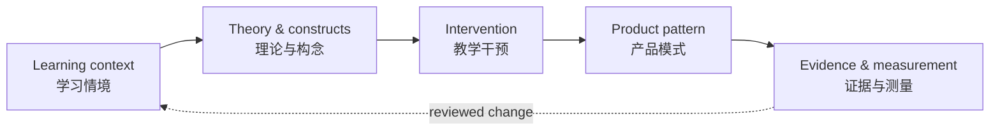

# Learning Design Portfolio
## 学习设计作品集

**Yajing Liu · 刘亚静** 
MA Digital Teaching and Learning · University of Nottingham 
诺丁汉大学数字教学与学习硕士

**From a learning difficulty to a design that can be explained, made and checked.** 
**从一个学习困难出发，走向能够被解释、被制作、被检验的设计。**

[Selected work / 精选作品](#selected-work--精选作品) · [Two original papers / 两篇原生论文](#two-original-papers--两篇原生论文) · [Learning Infrastructure / 学习基础设施](#learning-infrastructure--学习基础设施)

> I design the conditions around learning: the task a learner can see, the support they can use, the judgement they must retain, and the evidence that tells us what changed. 
> 我设计的是学习发生的条件：学习者看得见的任务、可以使用的支持、必须保留的判断，以及能够说明发生了什么变化的证据。

## A design lens / 我的设计视角

| 01 · **Observe / 看见** | 02 · **Explain / 解释** | 03 · **Make / 制作** | 04 · **Check / 检验** |
| --- | --- | --- | --- |
| Start with a real learner, context and constraint.   从真实学习者、情境与限制出发。 | Connect theory to a teachable mechanism.   把理论连接到可教学的机制。 | Turn the mechanism into a material, activity or product pattern.   把机制转为材料、活动或产品模式。 | Separate evidence, inference and hypothesis.   区分证据、推断与待验证假设。 |

This is the shared logic across my coursework, original research and the **Learning Infrastructure** prototype: **learning context → theory → intervention → product pattern → evidence and measurement**.

这条逻辑贯穿我的课程作品、原生研究和 **Learning Infrastructure** 原型：**学习情境 → 理论 → 教学干预 → 产品模式 → 证据与测量**。

## Selected work / 精选作品

### 01 · A Learning Analysis for Year 7 Chemistry · 「物质的微粒性」学习分析

[Read the paper / 阅读论文](papers/01_Year7-Chemistry-Learning-Analysis_EDUC4029.docx)

**Question / 问题** · Why is the particulate nature of matter difficult for an 11-year-old, and what support could make an invisible model learnable? 
**Design move / 设计动作** · Connect cognition, constructivism and metacognition to conceptual-change activities and multimedia explanations. 
**关键词** · conceptual change · misconceptions · multimedia learning · 概念转变 · 迷思概念 · 多媒体学习

### 02 · Supermarket Challenge · Research Proposal · 「超市大挑战」研究提案

[Read the proposal / 阅读提案](papers/02_Supermarket-Challenge_Research-Proposal_EDUC4032.docx)

**Question / 问题** · How can a vocabulary game make practice purposeful rather than decorative? 
**Design move / 设计动作** · Use Self-Determination Theory and Flow to choose mechanics that support autonomy, competence and sustained attention, then test the design through DBR. 
**关键词** · gamification · self-determination theory · flow · design-based research · 游戏化 · 自我决定理论 · 心流 · 设计型研究

### 03 · Makerspaces & AI · ISLS 2027 short paper · 创客空间与 AI

[Read the blinded version / 阅读双盲版](papers/03_Makerspace-and-AI_ISLS2027-SHORT-PAPER-BLINDED.md)

**Question / 问题** · How does a member-governed makerspace negotiate the place of AI? 
**Design move / 设计动作** · Trace governance, mutual witnessing and bounded assistance: AI may help, while verification and responsibility remain human. 
**关键词** · makerspace · commons governance · AI-mediated practices · informal learning · 创客空间 · 公共资源治理 · AI 中介实践 · 非正式学习

### 04 · Project Thamus · Critical thinking and AI · 批判性思维与 AI

[Bilingual paper page / 双语论文页](papers/04_Thamus-Critical-Thinking-and-AI_EDUC4062.md) · [Original PDF / 原文 PDF](papers/04_Thamus-Critical-Thinking-and-AI_EDUC4062.pdf)

An AI writing companion for first-year university students with limited academic-writing experience. It protects **productive struggle** by asking questions, surfacing reasoning and fading support instead of generating a finished essay.

面向学术写作经验有限的大学一年级学生的 AI 写作伴侣。它通过提问、显化推理和逐步淡出支持来保护 **productive struggle（有益的认知挣扎）**，而不是直接生成完整论文。

### 05 · Decentralised Collaboration and AI-Mediated Practices · 去中心化协作与 AI 中介实践

[Bilingual paper page / 双语论文页](papers/05_CollabMakerspace-and-AI_ISLS2027.md) · [Original PDF / 原文 PDF](papers/05_CollabMakerspace-and-AI_ISLS2027.pdf)

An interpretivist case study of a UK member-governed makerspace. It names three conditions for continuity: **reputational authority**, **mutual witnessing**, and **selective absorption of AI**.

一项关于英国成员自治创客空间的解释性质性个案研究。论文提出三项维持社区持续性的条件：**声誉权威**、**相互见证**和 **对 AI 的选择性吸收**。

## Two original papers / 两篇原生论文

These papers show two scales of learning design: one protects the learner’s thinking during an individual writing process; the other protects accountable participation in a community. Together they make the Learning Infrastructure model more than a software pipeline: it is also a way to reason about human agency, access and responsibility.

这两篇论文展示了学习设计的两个尺度：一篇保护个体写作过程中的思考，另一篇保护社区中的可问责参与。它们共同说明，Learning Infrastructure 不只是软件流程，也是一种讨论人的能动性、可及性与责任的方式。

| Paper / 论文 | Learning problem / 学习问题 | Design contribution / 设计贡献 | Evidence boundary / 证据边界 |
| --- | --- | --- | --- |
| **Thamus** | AI can remove the effort through which critical thinking develops.   AI 可能移除批判性思维赖以发展的认知努力。 | A five-stage, question-first AI guide with fading scaffolds.   五阶段、先提问、逐步淡出的 AI 支架。 | Design proposal; outcomes still require a supervised pilot.   设计提案；学习结果仍需受监督试验。 |
| **CollabMakerspace** | Voluntary communities must coordinate trust, contribution and AI boundaries.   自愿型社区必须协调信任、贡献与 AI 边界。 | Reputational authority, mutual witnessing and bounded assistance as design concepts.   将声誉权威、相互见证与有边界的辅助转为设计概念。 | Nine participants at one site; no causal or statistical generalisation.   单一地点九名参与者；不做因果或统计普遍化。 |

### The two papers in the infrastructure schema / 两篇论文如何进入基础设施 Schema

| Layer / 层级 | Thamus | CollabMakerspace |
| --- | --- | --- |
| Context / 情境 | First-year HE writers / 大学一年级写作者 | Voluntary member-governed making / 自愿参与的成员自治制作 |
| Theory / 理论 | Critical thinking, SRL, productive struggle, scaffolding / 批判性思维、自我调节、productive struggle、支架 | Commons governance, SDT, sociomateriality, situated learning / 公共治理、SDT、社会物质性、情境学习 |
| Intervention / 干预 | Prompts, staged inquiry, fading / 提示、分阶段探究、淡出 | Visible contribution, peer recognition, accountable verification / 可见贡献、同伴认可、问责核验 |
| Product pattern / 产品模式 | Question-first AI writing companion / 先提问的 AI 写作伴侣 | Community protocol for provenance and review / 来源与审查可见的社区协议 |
| Measurement / 测量 | Independent reasoning, process traces, revision quality / 独立推理、过程记录、修改质量 | Participation, access, trust and responsibility / 参与、准入、信任与责任 |

## Learning Infrastructure / 学习基础设施

The prototype turns a concrete learning difficulty into a reviewable design. It keeps theory, intervention and product pattern as distinct objects, retrieves research methods in relation to the claim being tested, and carries uncertainty forward instead of hiding it.

这个原型把具体学习困难转化为可审查的设计。它把理论、教学干预和产品模式分别建模，根据待检验主张选择研究方法，并把不确定性带到后续流程，而不是将其隐藏。

**Current prototype / 当前原型** · deterministic Python + JSON design core; Node.js teaching-deck generation; HTML/CSS/JavaScript learner practice; Markdown/JSON review records. The private project window currently records 50 theory and construct records, 20 interventions, 18 product patterns, 47 research methods, 9 social contexts and 10 AI capability definitions with evaluation templates.

**当前原型** · Python + JSON 确定性设计核心；Node.js 教学 PPT 生成；HTML/CSS/JavaScript 学生练习；Markdown/JSON 审查记录。私有项目窗口当前记录 50 条理论与构念、20 项干预、18 种产品模式、47 种研究方法、9 类社会情境，以及 10 项带评估模板的 AI 能力定义。

### First course case / 首个课程案例

**A first conversation in Chinese / 第一次中文交流** is a six-lesson design for children learning Chinese as a second language in a UK independent primary school. The outcome is deliberately observable: can a child move from recognising characters and supported pronunciation to an independent, meaningful exchange?

**第一次中文交流**面向英国私立小学中学习汉语作为第二语言的儿童，设计为六课时。目标被刻意写成可观察的表现：孩子能否从认字和有支持的发音，走向独立、有意义的交流？

→ [Course design / 课程设计](https://github.com/K-LIU2016/learning-infrastructure/blob/main/docs/first-course.md) · [Generated deliverables / 生成成果](https://github.com/K-LIU2016/learning-infrastructure/blob/main/docs/showcase.md) · [Architecture / 架构](https://github.com/K-LIU2016/learning-infrastructure/blob/main/docs/architecture.md)

## Evidence and next steps / 证据与下一步

- **Observed / 已观察** · The Learning Infrastructure prototype passed 67 automated tests across four design contexts on 3 November 2026. The checks cover software structure and selected boundaries; they do not establish classroom effectiveness. 
  2026 年 11 月 3 日，Learning Infrastructure 原型在四种设计情境下通过 67 项自动测试。测试覆盖软件结构与部分边界，不证明课堂成效。
- **Designed / 已设计** · Future pilots should measure independent learner outcomes, retention, transfer, learner experience and total teacher time. 
  后续试验应测量学生独立表现、保持、迁移、学习体验和教师总用时。
- **Next / 下一步** · Build a bilingual natural-language intake, a versioned observation pipeline and a supervised first pilot. 
  建立双语自然语言入口、有版本的观察流程和首次受监督试验。

The numbers above describe registered design content and software checks, not equally strong evidence or validated products. The two papers are likewise presented with their limits visible.

以上数字描述的是已注册的设计内容与软件检查，不代表同等强度的证据或已经验证的产品。两篇论文也都明确保留各自的证据边界。

## License / 许可

These are the author’s original academic works. Free to read and share with attribution; commercial use requires permission. 
本作品集为作者原创学术作品：注明出处即可自由阅读与分享，商用需授权。
